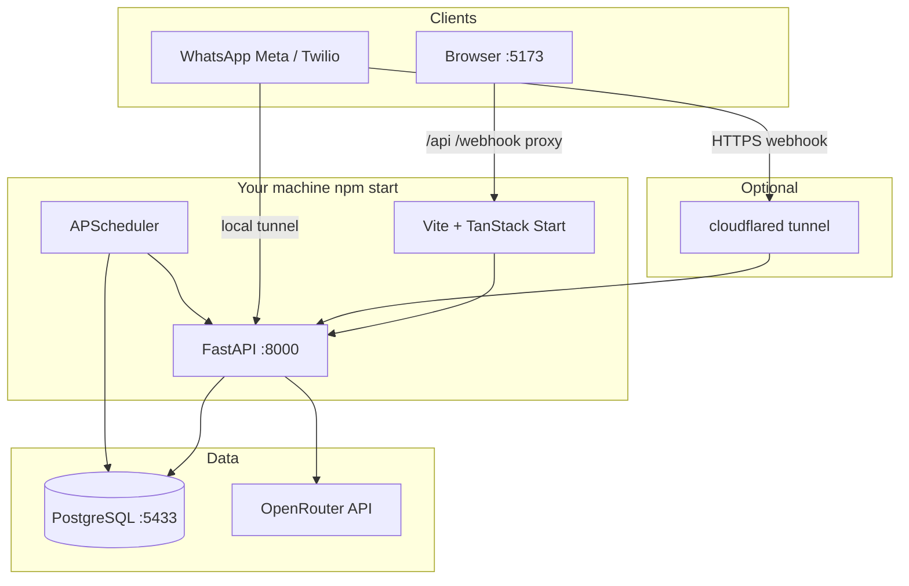
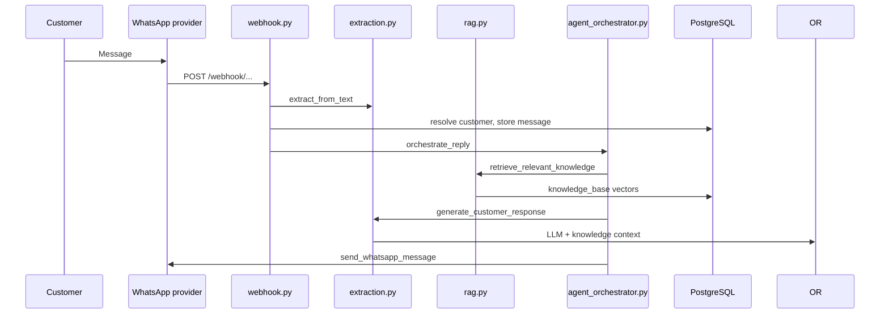

# OpsMemory

**Mission Control for WhatsApp-first businesses**

OpsMemory ingests customer conversations from a dedicated WhatsApp Business number, extracts structured operational signals, stores durable tenant memory, runs specialized AI agents, and surfaces decisions on a live dashboard. Business owners configure products, policies, and contact details through an onboarding flow; that data is indexed immediately so WhatsApp replies draw from the same knowledge base.

Built for operational SMEs (distribution, logistics, food, services) and extended with hackathon capabilities (review simulation and conversational recommendations over large review datasets).

Repository: [github.com/FavourOgboi/OpsMemory](https://github.com/FavourOgboi/OpsMemory)

---

## Table of contents

1. [System overview](#1-system-overview)
2. [Architecture](#2-architecture)
3. [Prerequisites](#3-prerequisites)
4. [Quick start (one command)](#4-quick-start-one-command)
5. [Full setup from a fresh clone](#5-full-setup-from-a-fresh-clone)
6. [Configuration reference](#6-configuration-reference)
7. [Using the application](#7-using-the-application)
8. [WhatsApp webhooks (optional)](#8-whatsapp-webhooks-optional)
9. [Development commands](#9-development-commands)
10. [Database and migrations](#10-database-and-migrations)
11. [Deployment](#11-deployment)
12. [Troubleshooting](#12-troubleshooting)
13. [Repository layout](#13-repository-layout)
14. [Security](#14-security)

---

## 1. System overview

OpsMemory is organized in five layers:

| Layer | Responsibility |
|-------|----------------|
| Input | WhatsApp (Meta Cloud API or Twilio sandbox), optional voice |
| Extraction | Intent, amounts, language, payment cues, product mentions |
| Memory | PostgreSQL: customers, messages, orders, knowledge base, agent actions |
| Agents | Collections, Churn, Deal, Fulfillment, Revenue Pulse, Relationship Health |
| Output | WhatsApp replies, dashboard alerts, approvals, CEO email digests |

**Multi-tenancy:** Every record is scoped by `business_id`. One pairing code maps to one workspace.

**Onboarding to WhatsApp answers:** The six-step setup form persists business profile and catalog text into PostgreSQL and embeds them in `knowledge_base`. Incoming WhatsApp messages trigger retrieval-augmented generation before a reply is sent.

---

## 2. Architecture

### 2.1 Runtime diagram (local development)



### 2.2 Request path (WhatsApp message to reply)



### 2.3 Technology stack

| Component | Technology |
|-----------|------------|
| Frontend | React 19, TanStack Router/Start, Zustand, Tailwind CSS v4, Vite 7 |
| Backend | FastAPI, Uvicorn, APScheduler (timezone Africa/Lagos) |
| Database | PostgreSQL 15+ with pgvector image (optional extension) |
| LLM / embeddings | OpenRouter (GPT-4o-mini class models, text-embedding-3-small) |
| Auth | Local accounts: bcrypt + JWT (`app_users`, no Clerk required for dev) |
| Packaging | Docker Compose for Postgres only; app runs on host for hot reload |

---

## 3. Prerequisites

Install the following before cloning:

| Tool | Version | Purpose |
|------|---------|---------|
| Git | any recent | Clone the repository |
| Node.js | 20 or newer | Frontend and `npm start` orchestration |
| npm | 10 or newer | Installed with Node |
| Python | 3.10 or newer (3.11 recommended) | Backend API |
| Docker | 24 or newer (recommended) | PostgreSQL without a local server install |
| OpenRouter account | n/a | API key for LLM and embeddings ([openrouter.ai/keys](https://openrouter.ai/keys)) |

Optional:

| Tool | Purpose |
|------|---------|
| cloudflared | Public HTTPS URL for WhatsApp webhooks on a laptop or VM |
| psql | Manual SQL if you prefer CLI migrations |

**Hardware:** 4 GB RAM minimum for Docker Postgres plus dev servers; 8 GB recommended if ingesting large Yelp JSON files.

---

## 4. Quick start (one command)

After prerequisites are installed:

```bash
git clone https://github.com/FavourOgboi/OpsMemory.git
cd OpsMemory
npm run setup
```

Edit `opsmemory-backend/.env` and set:

```env
OPENROUTER_API_KEY=sk-or-v1-your-key-here
```

Start everything:

```bash
npm start
```

This single command:

1. Starts PostgreSQL in Docker on port **5433** (unless you pass `--no-docker`)
2. Runs database migrations
3. Starts the FastAPI backend on **http://localhost:8000**
4. Starts the Vite frontend on **http://localhost:5173**

Open **http://localhost:5173/sign-up**, create an account, complete onboarding (business name, catalog lines, policies), then use the dashboard.

**With WhatsApp webhooks** (requires `cloudflared` installed):

```bash
npm run dev:tunnel
```

The tunnel prints a public URL; configure it in Meta or Twilio as described in [Section 8](#8-whatsapp-webhooks-optional).

---

## 5. Full setup from a fresh clone

Follow these steps if you want explicit control or if `npm start` fails.

### Step 1: Clone the repository

```bash
git clone https://github.com/FavourOgboi/OpsMemory.git
cd OpsMemory
```

### Step 2: Create environment files

```bash
cp opsmemory-backend/.env.example opsmemory-backend/.env
cp .env.example .env.local
```

Open `opsmemory-backend/.env` and configure at minimum:

| Variable | Example | Required |
|----------|---------|----------|
| `OPENROUTER_API_KEY` | `sk-or-v1-...` | Yes |
| `OPSMEMORY_DB_HOST` | `localhost` | Yes |
| `OPSMEMORY_DB_PORT` | `5433` (Docker) or `5432` (local Postgres) | Yes |
| `OPSMEMORY_DB_NAME` | `opsmemory` | Yes |
| `OPSMEMORY_DB_USER` | `postgres` | Yes |
| `OPSMEMORY_DB_PASSWORD` | `postgres` | Yes |
| `SECRET_KEY` | random 32+ character string | Yes |
| `JWT_SECRET` or app default | change in production | Recommended |
| `APP_ENV` | `development` | Yes for local |
| `BASE_URL` | `http://localhost:8000` | Yes |

Frontend `.env.local` may leave `VITE_API_BASE_URL` empty in development; Vite proxies `/api` and `/webhook` to port 8000.

### Step 3: Install frontend dependencies

```bash
npm install
```

### Step 4: Install backend dependencies

```bash
cd opsmemory-backend
python3 -m venv venv
source venv/bin/activate          # Windows: venv\Scripts\activate
pip install -r requirements.txt
cd ..
```

### Step 5: Start PostgreSQL

**Option A (recommended): Docker**

```bash
docker compose -f docker-compose.dev.yml up -d postgres
```

Wait until healthy:

```bash
docker compose -f docker-compose.dev.yml ps
```

**Option B: Existing PostgreSQL server**

Create the database:

```sql
CREATE DATABASE opsmemory;
```

Set `OPSMEMORY_DB_PORT` and credentials in `opsmemory-backend/.env` to match your instance.

### Step 6: Run migrations

```bash
cd opsmemory-backend
source venv/bin/activate
python scripts/migrate_all.py
```

Optional patch for onboarding columns (if not already applied):

```bash
PGPASSWORD=postgres psql -h localhost -p 5433 -U postgres -d opsmemory \
  -f migrations/007_onboarding_business_fields.sql
```

### Step 7: Seed demo catalog (optional)

Requires a valid `OPENROUTER_API_KEY` (embeddings):

```bash
cd opsmemory-backend
source venv/bin/activate
python scripts/seed_bola_catalog.py
```

### Step 8: Ingest hackathon Yelp data (optional)

Place Yelp JSON exports under `opsmemory-backend/data/`, then:

```bash
python scripts/ingest_datasets.py
```

This powers Review Intelligence and Recommendation Engine pages. It is not required for core WhatsApp and dashboard flows.

### Step 9: Start the stack

From the repository root:

```bash
npm start
```

Verify:

| URL | Expected |
|-----|----------|
| http://localhost:8000/health | `{"status":"ok",...}` |
| http://localhost:8000/docs | OpenAPI UI |
| http://localhost:5173 | Landing page |
| http://localhost:5173/dashboard | Dashboard after sign-in |

### Step 10: Create a business via onboarding

1. Visit http://localhost:5173/sign-up
2. Register name, email, password
3. Complete all six onboarding steps
4. On step 4, enter product lines (example: `Rice 50kg - 45000`) or upload a PDF catalog
5. Finish and open the dashboard

Send a test message through WhatsApp only after [Section 8](#8-whatsapp-webhooks-optional) is configured.

---

## 6. Configuration reference

### 6.1 Backend (`opsmemory-backend/.env`)

| Variable | Description |
|----------|-------------|
| `OPSMEMORY_DB_*` | PostgreSQL connection |
| `OPENROUTER_API_KEY` | LLM, embeddings, transcription |
| `OPENROUTER_BASE_URL` | Default `https://openrouter.ai/api/v1` |
| `META_WHATSAPP_*` | Meta Cloud API (token, verify token, phone number id) |
| `META_APP_SECRET` | Webhook HMAC verification (production) |
| `TWILIO_*` | Twilio WhatsApp sandbox |
| `WHATSAPP_PROVIDER` | `auto`, `meta`, or `twilio` |
| `SMTP_*` | CEO morning digest email |
| `BASE_URL` | Public URL for webhooks and links |
| `APP_ENV` | `development` or `production` |

Deprecated placeholders (leave empty): `SUPABASE_*`, `CLERK_*`.

### 6.2 Frontend (`.env.local`)

| Variable | Description |
|----------|-------------|
| `VITE_API_BASE_URL` | Empty in dev (proxy). Set to backend URL in production builds. |
| `VITE_CLERK_PUBLISHABLE_KEY` | Only if re-enabling Clerk |

---

## 7. Using the application

### 7.1 Main URLs

| Page | Path |
|------|------|
| Landing | `/` |
| Sign up | `/sign-up` |
| Sign in | `/sign-in` |
| Onboarding | `/onboarding` |
| Dashboard | `/dashboard` |
| Customers | `/dashboard/customers` |
| Approvals | `/dashboard/approvals` |
| Knowledge base | `/dashboard/knowledge` |
| Review Intelligence (Task A) | `/dashboard/review-intelligence` |
| Recommendations (Task B) | `/dashboard/recommendations` |

### 7.2 Demo access (judges / quick review)

| Action | Location |
|--------|----------|
| Double-click the OpsMemory logo | Sign-in or sign-up page → dashboard without registration |
| Triple-click the sidebar logo | Toggle demo mode |

### 7.3 Background jobs (Africa/Lagos)

| Job | Schedule | Purpose |
|-----|----------|---------|
| `morning_digest` | 07:00 daily | CEO email for connected businesses |
| `agent_sweep` | Every 30 minutes | Proactive agent evaluation per customer |
| `campaign_continuations` | Every 4 hours | Collections / Churn / Deal campaign steps |

---

## 8. WhatsApp webhooks (optional)

Replace `{BASE_URL}` with your public HTTPS origin (from `npm run dev:tunnel` or production host).

Replace `{BUSINESS_ID}` with your tenant UUID from the database or onboarding completion response.

### 8.1 Meta WhatsApp Cloud API

| Setting | Value |
|---------|--------|
| Callback URL | `{BASE_URL}/webhook/whatsapp/{BUSINESS_ID}` |
| Verify token | Same as `META_WHATSAPP_VERIFY_TOKEN` in `.env` |
| Method | GET verify, POST messages |

### 8.2 Twilio sandbox

| Setting | Value |
|---------|--------|
| When a message comes in | `{BASE_URL}/webhook/twilio/{BUSINESS_ID}` |
| Method | HTTP POST |

Use `/webhook/twilio/`, not `/webhook/whatsapp/`, for Twilio traffic.

### 8.3 Verify Meta token

```bash
curl -s "https://graph.facebook.com/v25.0/${META_PHONE_NUMBER_ID}" \
  -H "Authorization: Bearer ${META_WHATSAPP_TOKEN}"
```

---

## 9. Development commands

| Command | Description |
|---------|-------------|
| `npm run setup` | First-time install: env files, npm, venv, pip, Docker Postgres, migrations |
| `npm start` | Start Postgres (Docker), migrate, backend, frontend |
| `npm run dev` | Alias for `npm start` |
| `npm run dev:tunnel` | Same as start plus Cloudflare quick tunnel |
| `npm run dev:frontend` | Frontend only (port 5173) |
| `npm run dev:backend` | Backend only (port 8000) |
| `npm run db:up` | Start Postgres container |
| `npm run db:down` | Stop Postgres container |
| `npm run db:migrate` | Run `migrate_all.py` |
| `npm run build` | Production frontend build |
| `make start` | Same as `npm start` (Unix Makefile) |

Flags for `node scripts/start.mjs`:

| Flag | Effect |
|------|--------|
| `--no-docker` | Do not start Docker; use existing Postgres |
| `--skip-setup` | Skip auto setup when node_modules and venv exist |
| `--tunnel` | Start cloudflared (same as `npm run dev:tunnel`) |

---

## 10. Database and migrations

### 10.1 Connection defaults (Docker)

| Setting | Value |
|---------|--------|
| Host | `localhost` |
| Port | `5433` |
| Database | `opsmemory` |
| User | `postgres` |
| Password | `postgres` |

### 10.2 Migration order (manual)

If you do not use `migrate_all.py`, apply SQL files in order:

1. `migrations/001_initial_schema.sql`
2. `migrations/002_agent_campaigns.sql`
3. `migrations/003_seed_data.sql` (optional demo)
4. `migrations/004_knowledge_base.sql`
5. `migrations/005_schema_updates.sql`
6. `migrations/005_bola_agro_demo.sql` (optional)
7. `migrations/006_sync_demo_dashboard.sql` (optional)
8. `migrations/007_onboarding_business_fields.sql`

Unified script (recommended):

```bash
cd opsmemory-backend && python scripts/migrate_all.py
```

### 10.3 Evaluation (hackathon metrics)

```bash
cd opsmemory-backend
python scripts/evaluate.py --task a --samples 15
python scripts/evaluate.py --task b --samples 10
```

---

## 11. Deployment

### 11.1 Docker Compose (full stack)

Production-oriented compose (builds images, no hot reload):

```bash
docker compose up --build
```

Maps frontend preview to port 4173 and backend to 8000. Provide `opsmemory-backend/.env` before starting.

### 11.2 Render / VPS

| Layer | Suggestion |
|-------|------------|
| Frontend | Vercel, Cloudflare Pages, or static hosting with `VITE_API_BASE_URL` |
| Backend | Render, Fly.io, or systemd on a VPS |
| Database | Managed PostgreSQL with pgvector if available |
| Webhooks | Named Cloudflare Tunnel or fixed TLS domain |

Set `APP_ENV=production`, strong `SECRET_KEY` and `JWT_SECRET`, and restrict CORS in `main.py` to your frontend origin.

### 11.3 systemd (Linux server)

Unit files are provided under `deploy/systemd/`:

```bash
sudo cp deploy/systemd/opsmemory-backend.service /etc/systemd/system/
sudo cp deploy/systemd/opsmemory-cloudflared.service /etc/systemd/system/
sudo systemctl daemon-reload
sudo systemctl enable opsmemory-backend opsmemory-cloudflared
sudo systemctl start opsmemory-backend
```

---

## 12. Troubleshooting

### PostgreSQL connection refused

Confirm Docker is running and port 5433 is free:

```bash
docker compose -f docker-compose.dev.yml ps
npm run db:up
```

Align `OPSMEMORY_DB_PORT` in `.env` with the port you use.

### `OPENROUTER_API_KEY` errors

Onboarding catalog indexing and WhatsApp replies require embeddings. Add a valid key and restart `npm start`.

### Dashboard empty after sign-in

Check http://localhost:8000/health. Open browser devtools → Network → confirm `/api/customers/` returns 200.

### Meta replies appear on Twilio

Refresh `META_WHATSAPP_TOKEN`. Ensure webhook paths match the provider (Meta vs Twilio).

### Migrations fail on `vector` extension

Safe on dev: embeddings use JSONB cosine fallback in `rag.py`. Install pgvector image (`docker-compose.dev.yml` already uses `pgvector/pgvector`).

### Port already in use

| Port | Process |
|------|---------|
| 5173 | Vite |
| 8000 | Uvicorn |
| 5433 | Postgres Docker |

Stop conflicting services or change ports in `vite` and uvicorn arguments.

---

## 13. Repository layout

```text
OpsMemory/
├── src/                          # TanStack Start frontend
│   ├── routes/                   # File-based routes
│   ├── components/               # Dashboard, onboarding, knowledge UI
│   ├── store/                    # Zustand (auth, events, approvals)
│   └── lib/                      # api.ts, onboarding-api.ts
├── opsmemory-backend/
│   ├── main.py                   # FastAPI entry
│   ├── app/
│   │   ├── routers/              # API, webhooks, auth, onboarding
│   │   ├── services/             # agents, extraction, RAG, orchestrator
│   │   └── jobs/                 # Scheduler
│   ├── migrations/               # SQL schema and seeds
│   └── scripts/                  # migrate_all, ingest, evaluate, seed
├── scripts/
│   ├── setup.mjs                 # First-time setup
│   └── start.mjs                 # One-command dev stack
├── docker-compose.dev.yml        # Postgres only for local dev
├── docker-compose.yml            # Full stack build
├── package.json                  # npm start, setup, dev
├── vite.config.ts                # Proxy /api → :8000
├── wrangler.jsonc                # Cloudflare Workers entry
└── deploy/systemd/               # Production units
```

---

## 14. Security

**Never commit secrets.** These paths are gitignored:

| Path | Contents |
|------|----------|
| `opsmemory-backend/.env` | API keys, DB passwords |
| `.env.local` | Frontend overrides |
| `tunnel-url.txt` | Ephemeral tunnel URL |

Use `.env.example` files as templates only.

Before sharing the repository or opening a pull request:

```bash
git ls-files | grep -E '\.env$|\.env\.'
```

Rotate any key that was exposed in chat, screenshots, or old commits.

Production checklist:

1. Set `APP_ENV=production`
2. Set `META_APP_SECRET` for webhook HMAC
3. Use strong `SECRET_KEY` and `JWT_SECRET`
4. Restrict CORS to your frontend domain
5. Run the backend as a non-root user with `chmod 600` on `.env`

---

## License

Proprietary. All rights reserved.

## Acknowledgement

Developed for the DSN × BCT LLM Agent Challenge (2026). Core product focus: WhatsApp operational intelligence for SMEs. Hackathon modules: user modeling (Task A) and recommendation (Task B) over external review datasets.
